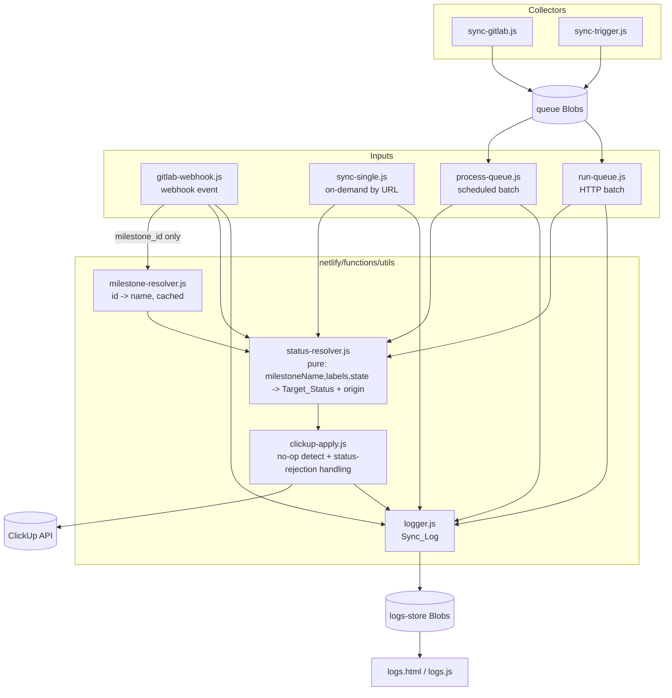
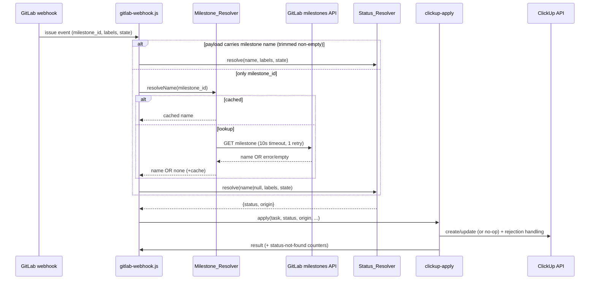
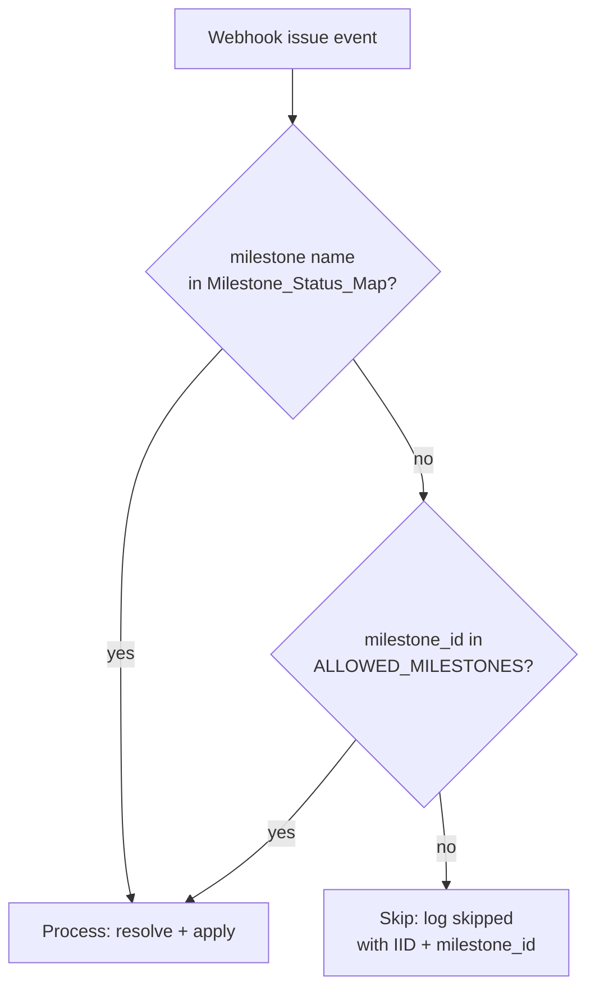

# Design Document

## Overview

This feature introduces a general GitLab-milestone → ClickUp-status mapping into the existing GitLab→ClickUp sync, and in doing so eliminates the status-resolution logic that is currently duplicated across four Netlify functions.

Today, ClickUp status is derived almost entirely from GitLab **labels** by a `getExpectedStatus(labels, issueState)` function that is copy-pasted — with a subtle ordering difference, see Research below — into `gitlab-webhook.js`, `sync-single.js`, `process-queue.js`, and `run-queue.js`. Milestones only ever influence status through one hard-coded special case: milestone ID `756` (`QA_MILESTONE_ID`) sets `pending review (qa)` **on task creation only**. There is no name-keyed milestone→status table.

The design:

1. Extracts a single shared **Status_Resolver** module (`netlify/functions/utils/status-resolver.js`) that is a **pure function** over `(milestoneName, labels, issueState)`. It owns the label rules, the new **Milestone_Status_Map**, the normalization rules, and the precedence (`closed` > milestone > label). All four sync paths call it; none keeps its own copy.
2. Adds a **Milestone_Resolver** (`netlify/functions/utils/milestone-resolver.js`) that turns a GitLab `milestone_id` into a milestone name on the webhook path (where the payload has no name), via a GitLab milestones API lookup with a 10s timeout, one retry, and per-invocation caching.
3. Seeds the Milestone_Status_Map with the two new entries and keeps the existing `QA_MILESTONE_ID` creation behavior intact.
4. Centralizes ClickUp status application so that updates compare against the task's current status (no-op detection) and handle ClickUp "status does not exist" rejections (create → single `Open` retry; update → no retry).
5. Admits the two new milestones into the sync scope on both the scheduled path (by name, via `GITLAB_MILESTONES`) and the webhook path (by name match even when the milestone ID is not in `ALLOWED_MILESTONES`).
6. Records the status origin (milestone vs label vs none) and the milestone name in the Sync_Log and surfaces them on the Logs page.

### Goals

- One place to add a milestone mapping; it takes effect on every sync path.
- Milestone-driven statuses win over stale development labels for open issues.
- No regression to existing label-derived statuses, tag derivation, or the `756` QA behavior.
- Clear, queryable signal when a mapped status is missing from the ClickUp list.

### Non-Goals

- Changing how tasks are matched/searched in ClickUp (name-prefix / URL search is unchanged).
- Changing assignee mapping logic beyond preserving the existing `DEFAULT_ASSIGNEE_ID` QA behavior and adding a log line when the configured value is unusable.
- Changing the queue storage model, the Blobs persistence, or the schedule cadence.

### Research Summary

Findings from inspecting the current code that shaped this design:

- **The four `getExpectedStatus()` copies are not identical.** In `gitlab-webhook.js` the order is `For Testing` → `For Deployment to Hotfix`; in the other three it is `For Deployment to Hotfix` → `For Testing`. These labels map to different statuses (`for testing in hotfix` vs `for deployment to hotfix`), so an issue carrying both labels resolves differently on the webhook path than on the scheduled/manual paths today. The shared resolver must pick **one** canonical order. Requirement 3.6 ("same Label_Status that the pre-change `getExpectedStatus()` implementation produces") cannot literally hold for both orderings simultaneously; this is called out as an open decision below.
- **`getExpectedTags()` is identical** across all four files and must be preserved verbatim (Req 3.7). It moves into the shared module unchanged.
- **`hasLabel()` differs**: webhook/sync-single compare `l.title`; process-queue/run-queue accept either a string or `{title}`. The shared resolver must accept both shapes because queued items store labels as raw strings from the GitLab API while webhook/sync-single build `{title}` objects.
- **The webhook payload exposes only `object_attributes.milestone_id`**, no name — this is why the Milestone_Resolver and a GitLab milestones API lookup are needed on that path. The scheduled/manual paths already have `issue.milestone.title` (sync-single) / `milestone_name` (queue items), so they do not need the resolver.
- **The existing QA special case is creation-only** and lives inline in three of the four files (sync-single, process-queue, run-queue, webhook). It must be preserved and must only apply when the resolver yields no status.
- **`DEFAULT_ASSIGNEE_ID` is applied only in `gitlab-webhook.js`** (the queue processors never set a default assignee). Requirement 3.3–3.5 scope the default-assignee behavior to the Webhook_Handler, matching the current code.
- **Current update behavior varies**: `process-queue.js`/`run-queue.js` already compare `existing.status !== expectedStatus` before setting status (case-sensitive, exact), while `gitlab-webhook.js`/`sync-single.js` set status unconditionally when present. The new centralized apply logic standardizes on normalized (trim + case-insensitive) comparison (Req 6.2/6.3).
- **The Sync_Log schema** (`logger.js` / `logs-store.js`) has fixed fields: `source, action, status, duration, issueIid, issueTitle, clickupTaskId, clickupStatus, milestone, labels, error, details`. There is no field for status origin. Adding observability (Req 8.2/8.3/8.6) requires extending this schema and the Logs page renderer (`logs.js`, `renderLogEntry`).
- **No test framework exists.** `package.json` has only `@netlify/blobs` and `netlify-cli`. The design proposes adding a dev-only runner plus a property-based testing library for the pure resolver.

### Open Decisions (carried from requirements)

- **Canonical label order.** The design adopts the **webhook ordering** (`For Testing` before `For Deployment to Hotfix`) as canonical, because the webhook is the real-time path and the most frequently exercised. This means issues carrying *both* `For Testing` and `For Deployment to Hotfix` will, on the scheduled/manual paths, change from `for deployment to hotfix` to `for testing in hotfix`. This is a behavior change on an edge case (both labels present at once). **Please confirm** this is acceptable, or specify the preferred order.

## Architecture

### Current vs Target

Today each sync path is self-contained: it embeds its own copy of `hasLabel`, `getExpectedStatus`, `getExpectedTags`, the QA-milestone special case, and its own ClickUp apply logic.

The target introduces a thin shared layer under `netlify/functions/utils/` that the four paths delegate to:



### Status resolution sequence (webhook path, the only path needing name resolution)



### Admission / scope decision (webhook)



### Module boundaries

| Module | Responsibility | Pure? |
| --- | --- | --- |
| `utils/status-resolver.js` | Milestone_Status_Map, normalization, label rules, tag rules, precedence. Produces `{ status, origin }`. | Yes — no I/O |
| `utils/milestone-resolver.js` | `milestone_id` → name via GitLab API, 10s timeout, 1 retry, per-invocation cache. | No (network), but cache is in-memory per factory instance |
| `utils/clickup-apply.js` | Build create/update requests, no-op detection, status-rejection detection + retry/fallback, status-not-found counting. | No (ClickUp I/O) |
| `utils/logger.js` (extended) | Sync_Log entry, now including `statusOrigin` and normalized `milestone`. | No (I/O) |

Keeping the Status_Resolver pure is the central architectural decision: it makes the precedence and normalization rules unit- and property-testable without any network, and it guarantees all four paths behave identically because they share one implementation.

## Components and Interfaces

### 1. Status_Resolver (`netlify/functions/utils/status-resolver.js`)

Pure module. No `fetch`, no `process.env` reads at call time for the map itself (the map is a module constant; see Data Models). Exported surface:

```js
// Normalize a milestone name/key for comparison:
// trim, collapse internal whitespace runs to single space, lowercase.
function normalizeMilestone(name) // -> string

// Label-derived status (the canonical merge of the four getExpectedStatus copies).
function getLabelStatus(labels, issueState) // -> string | null

// Tag derivation (unchanged from current getExpectedTags).
function getExpectedTags(labels) // -> string[]

// Milestone-derived status via the map (null when no match / invalid name).
function getMilestoneStatus(milestoneName) // -> string | null

// The single entry point used by all sync paths.
// Returns a Target_Status plus its origin for observability.
function resolveStatus(milestoneName, labels, issueState) // -> { status: string | null, origin: 'milestone' | 'label' | 'none' }

module.exports = {
  MILESTONE_STATUS_MAP,
  normalizeMilestone,
  getLabelStatus,
  getExpectedTags,
  getMilestoneStatus,
  resolveStatus,
  STATUS_ORIGIN: { MILESTONE: 'milestone', LABEL: 'label', NONE: 'none' },
};
```

**`resolveStatus` algorithm (precedence closed > milestone > label):**

1. If `issueState === 'closed'` → `{ status: 'Closed', origin: 'label' }`. (Closed is a label-rule outcome in the current code; it is not a milestone outcome. See note below.)
2. Else compute `m = getMilestoneStatus(milestoneName)`. If `m !== null` → `{ status: m, origin: 'milestone' }`.
3. Else compute `l = getLabelStatus(labels, issueState)`. If `l !== null` → `{ status: l, origin: 'label' }`.
4. Else → `{ status: null, origin: 'none' }`.

> **Origin of `Closed`:** Requirement 2.1 ranks closed above both milestone and label. Requirement 8.2/8.3 ask that milestone-origin and label-origin be *distinct* values. `Closed` is produced by the closed-state branch, which is conceptually part of the label rules (it is the first line of every `getExpectedStatus`). The design tags `Closed` with origin `label` so that origin has exactly three values (`milestone`, `label`, `none`). This keeps Req 8 satisfiable without inventing a fourth origin. **Flagged for confirmation.**

**`getMilestoneStatus` algorithm (Req 1.7, 1.8, 2.9):**

- If `milestoneName` is absent/empty/`> 255` chars → `null`.
- Normalize the input. Iterate map entries **in configured (insertion) order**; return the value of the first entry whose normalized key equals the normalized input. This gives match-order determinism (Req 2.9) and first-wins on duplicate normalized keys.
- If the map is empty/unreadable → `null` (Req 2.8).

**`getLabelStatus`** is the canonical merge of the four copies (adopting webhook ordering per the open decision). It accepts labels as either `{title}` objects or raw strings via a tolerant `hasLabel`.

### 2. Milestone_Resolver (`netlify/functions/utils/milestone-resolver.js`)

Factory returning a resolver whose cache lives for the lifetime of one function invocation (Req 4.3, 4.6). The webhook handler constructs one per invocation.

```js
// Factory: creates an invocation-scoped resolver with its own cache.
function createMilestoneResolver({ gitlabUrl, token, projectId, fetchImpl = fetch }) {
  const cache = new Map(); // milestoneId(string) -> name(string) | null

  // Returns the milestone name, or null if unresolvable.
  async function resolveName(milestoneId) { /* ... */ }

  return { resolveName };
}
module.exports = { createMilestoneResolver };
```

**`resolveName` algorithm (Req 4.2, 4.4, 4.6):**

1. Key = `String(milestoneId)`. If `cache.has(key)` → return `cache.get(key)` (no request).
2. Otherwise call the GitLab milestones API with a 10s per-attempt timeout (via `AbortController`). On timeout/connection failure, retry **once**.
3. If the response status is `>= 400`, or both attempts time out/fail, or the returned milestone name is absent/empty after trim → cache `null` and return `null`.
4. Otherwise cache and return the trimmed name.

GitLab endpoint: project milestones support filtering, but the simplest correct lookup is `GET {gitlabUrl}/api/v4/projects/{projectId}/milestones/{milestoneId}` with header `PRIVATE-TOKEN`. (The existing collectors already use `GITLAB_URL`, `GITLAB_TOKEN`, `GITLAB_PROJECT_ID`.) Caching `null` as well as names ensures a failed lookup is not retried within the same invocation.

### 3. ClickUp_Apply (`netlify/functions/utils/clickup-apply.js`)

Encapsulates building and sending create/update requests, no-op detection, and status-rejection handling. Shared by all four paths so Req 6 and Req 7 behave identically everywhere.

```js
// Detects a ClickUp "status does not exist in list" rejection from a thrown error.
function isStatusNotFoundError(err) // -> boolean

// Normalized status equality (trim + case-insensitive) for no-op detection.
function statusEquals(a, b) // -> boolean

// Create path: applies Target_Status; on status-not-found, retries once with 'Open'.
// Returns { task, created: bool, statusNotFound: bool, fallbackUsed: bool } or throws for non-status errors.
async function createTask(clickupRequest, listId, body, { issueIid, milestoneName, listId }) // -> result

// Update path: compares Target_Status to current status; omits status field if equal.
// On status-not-found rejection, leaves task unchanged and does NOT retry.
// Returns { statusNotFound: bool, applied: bool }.
async function updateTask(clickupRequest, taskId, updates, currentStatus, targetStatus, { issueIid, milestoneName }) // -> result
```

**Create (Req 6.1, 7.1, 7.3, 7.4):**
- Build body with `status = targetStatus || 'Open'` (QA special case applied by caller before this — see below).
- POST. On success → done.
- On a status-not-found rejection → log one error entry (IID, milestone name, rejected status, list id), then retry once within 5s using `status: 'Open'` and all other fields identical. If the retry also fails with status-not-found → log one error (both mapped + Open rejected), do not create, mark `statusNotFound`.
- Non-status errors propagate (existing behavior).

**Update (Req 6.2, 6.3, 6.5, 6.6, 6.7, 7.2, 7.5):**
- Caller passes `currentStatus` (already fetched when finding the task — all four `findExistingTask`/`findTaskByUrl` already return `status`). If `currentStatus` is unknown/undefined and a Target_Status exists → include status (Req 6.6).
- If Target_Status is null → omit status entirely (Req 2.6), still apply name/assignee/tag updates (Req 6.7).
- If Target_Status present and `statusEquals(current, target)` → omit status field (Req 6.3), still apply other fields.
- If present and differs → include status (Req 6.2).
- PUT. On status-not-found rejection → leave task unchanged, do not retry (Req 7.5), log one error (IID, milestone name, rejected status, list id), mark `statusNotFound`.

**Batch counting (Req 7.6, 7.7):** `process-queue.js` / `run-queue.js` continue the batch on a status-not-found failure (they already catch per-issue errors) and accumulate a `statusNotFound` count that is written into the run-summary Sync_Log entry.

### 4. Sync path integration

Each of the four handlers is refactored to:

1. Delete its local `hasLabel`, `getExpectedStatus`, `getExpectedTags`, and inline QA special case.
2. `require('./utils/status-resolver')` and `require('./utils/clickup-apply')`.
3. Determine the milestone **name**:
   - `sync-single.js`: `issue.milestone?.title` (already available).
   - `process-queue.js` / `run-queue.js`: `item.milestone_name` (already in queue items).
   - `gitlab-webhook.js`: payload milestone name if present and non-empty after trim; otherwise `createMilestoneResolver(...).resolveName(milestone_id)`.
4. Call `resolveStatus(milestoneName, labels, issueState)` → `{ status, origin }`.
5. Apply the QA special case **only when `status === null`** on **create** (preserving today's semantics): if `milestoneId === QA_MILESTONE_ID` (string compare, both trimmed) then create-status becomes `pending review (qa)`; on the webhook path additionally apply `DEFAULT_ASSIGNEE_ID` when the issue yields zero assignees and the value is a decimal integer `> 0`, else zero assignees and (if the value was set-but-invalid) a Sync_Log note.
6. Use `clickup-apply` for create/update.
7. Log with `milestone` (trimmed, ≤255) and `statusOrigin`.

### 5. Issue_Collector scope (`sync-gitlab.js`, `sync-trigger.js`)

- Continue reading `GITLAB_MILESTONES` as a trimmed, comma-separated, empty-discarded list (Req 5.5). The two 2026 Review names are added to the configured value in `.env.example`/`README.md` (Req 5.1, 5.2, 5.6) rather than hard-coded, so operators control scope.
- Both collectors already loop milestone names and dedupe by `iid` (Req 5.9 already satisfied). Add per-milestone error isolation: wrap each `getIssuesByMilestone` call so an HTTP `>= 400` for one name logs an error Sync_Log entry naming the milestone and continues with the remaining names (Req 5.8). Currently a throw aborts the whole run.

### 6. Webhook admission (`gitlab-webhook.js`, Req 5.3, 5.4, 5.7)

Replace the current "milestone ID must be in `ALLOWED_MILESTONES`" gate with: process if the resolved milestone **name** is in the Milestone_Status_Map **or** the milestone **ID** is in `ALLOWED_MILESTONES`; otherwise skip and log a `skipped` entry carrying the IID and milestone ID. Because the name may require a lookup, the admission check resolves the name first (reusing the Milestone_Resolver), then checks the map, then falls back to the ID allowlist.

### 7. Observability (`logger.js`, `logs-store.js`, `logs.js`)

- Extend the log entry schema with `statusOrigin` (string: `milestone` | `label` | `none` | `null`) and keep `milestone` as the (trimmed, ≤255) milestone name, empty string when the issue has no milestone (Req 8.1, 8.5). Both `logger.js` (entry construction) and `logs-store.js` (POST normalization) gain the field.
- `logs.js` `renderLogEntry` displays milestone name and status origin; when either is absent it shows a "not recorded" indicator rather than dropping the detail (Req 8.4).
- Log-write failures never revert the ClickUp operation and the sync is still reported successful (Req 8.7) — this already holds because `logRun` swallows errors; the design preserves it.

## Data Models

### Milestone_Status_Map

An **ordered** list of `{ milestone, status }` pairs (array, not plain object) so that configured order is well-defined for match-order determinism (Req 2.9) and first-wins on duplicate normalized keys. Lives as a module constant in `status-resolver.js`.

```js
// Seed entries (Req 1.5, 1.6). Order is significant.
const MILESTONE_STATUS_MAP = [
  { milestone: '2026 Review - For QA Verification',  status: '2026 Review - QA'  },
  { milestone: '2026 Review - For Dev Verification', status: '2026 Review - Dev' },
];
```

Normalization applied to both keys and the lookup input: trim → collapse internal whitespace runs to a single space → lowercase. A match requires character-for-character equality of the normalized values. Inputs that are absent, empty, or `> 255` characters never match.

### Label rules (canonical, merged)

Preserved verbatim from the current `getExpectedStatus`, using the webhook ordering as canonical (open decision):

| GitLab label | ClickUp status |
| --- | --- |
| (issue state `closed`) | `Closed` |
| `RESOLVED - NO CODE CHANGES` | `resolved - no code changes` |
| `Released` | `released to prod` |
| `For Release` | `for release` |
| `Done` or `Done Development` | `done development` |
| `For Testing` | `for testing in hotfix` |
| `For Deployment to Hotfix` | `for deployment to hotfix` |
| `On-Going Testing` | `ongoing testing` |
| `On-Going Development` | `ongoing dev` |
| `Escalated to Dev` | `testing: failed` |
| (none of the above) | `null` |

### Tag rules (unchanged, Req 3.7)

| GitLab label | ClickUp tag |
| --- | --- |
| `Data Correction` | `data correction` |
| `Enhancement` | `enhancement` |
| `Lynexus` | `lynexus` |
| `Internal Enhancement` | `internal enhancement` |
| `openAPI` | `openapi` |
| `Chargeable` | `chargeable` |
| `For Investigation` | `for investigation` |

### Status resolution result

```js
{ status: string | null, origin: 'milestone' | 'label' | 'none' }
```

### Sync_Log entry (extended)

Existing fields plus the new `statusOrigin`. Run-summary entries additionally carry a status-not-found count.

```js
{
  id, timestamp, source, action, status,
  duration, issueIid, issueTitle,
  clickupTaskId, clickupStatus,
  milestone,          // trimmed, <=255 chars; '' when issue has no milestone
  statusOrigin,       // 'milestone' | 'label' | 'none' | null (NEW)
  labels, error, details,
  statusNotFoundCount // present on batch run-summary entries (NEW, optional)
}
```

### Milestone_Resolver cache

```js
Map<string /* milestoneId */, string | null /* name, or null when unresolvable */>
```
Created per invocation; discarded when the invocation ends. `null` is cached to prevent re-lookups of a known-bad ID within the same invocation.

### GitLab milestones API response (fields used)

```jsonc
// GET /api/v4/projects/{projectId}/milestones/{milestoneId}
{ "id": 756, "title": "2026 Review - For QA Verification", /* ...other fields ignored... */ }
```
Only `title` is read; everything else is ignored. HTTP `>= 400`, timeout on both attempts, or empty/absent `title` → no name.

## Correctness Properties

*A property is a characteristic or behavior that should hold true across all valid executions of a system — essentially, a formal statement about what the system should do. Properties serve as the bridge between human-readable specifications and machine-verifiable correctness guarantees.*

These properties target the pure **Status_Resolver** (`resolveStatus`, `getMilestoneStatus`, `getLabelStatus`, `getExpectedTags`) and the pure dedup logic in the Issue_Collector, which take plain data and return plain data with no I/O. The GitLab/ClickUp API behaviors (Req 4, 7) and Sync_Log persistence / Logs rendering (Req 8.4) are exercised by integration tests instead — see Testing Strategy.

### Property 1: Well-formed output (single-valued + consistent origin)

*For all* generated `(milestoneName, labels, issueState)` inputs, `resolveStatus` returns an object whose `status` is either `null` or exactly one string, and whose `origin` is exactly one of `milestone`, `label`, `none`, where `origin === 'none'` iff `status === null`, `origin === 'milestone'` iff the status came from a Milestone_Status_Map match, and `origin === 'label'` otherwise. The three origin values are pairwise distinct.

**Validates: Requirements 2.7, 8.2, 8.3, 8.6**

### Property 2: Idempotence and re-sync stability

*For all* generated inputs, `resolveStatus(input)` equals `resolveStatus(input)` across repeated calls; and for any resolved Target_Status, building an update request against a current status equal to that Target_Status (under normalization) produces no status field — so re-syncing an already-synced issue leaves the ClickUp status at the previously applied Target_Status.

**Validates: Requirements 2.7, 6.4**

### Property 3: Closed precedence

*For all* generated `(milestoneName, labels)` where `issueState === 'closed'`, `resolveStatus(...).status === 'Closed'`, regardless of the milestone name and regardless of any Label_Status derivable from the labels.

**Validates: Requirements 2.1**

### Property 4: Milestone dominance

*For all* generated label sets, when `milestoneName` normalizes to a Milestone_Status_Map key and `issueState === 'opened'`, `resolveStatus(...).status` equals the mapped status for that key and `origin === 'milestone'`, regardless of the labels.

**Validates: Requirements 2.2**

### Property 5: Normalization invariance

*For all* Milestone_Status_Map keys, inserting leading whitespace, trailing whitespace, or additional whitespace within an existing internal whitespace run, and/or changing letter case, yields the same Milestone_Status; and *for all* generated names that do not normalize to any key, `getMilestoneStatus` returns `null`.

**Validates: Requirements 1.7**

### Property 6: Length and absence error condition

*For all* generated milestone names longer than 255 characters, and for absent (`null`/`undefined`) or empty milestone names, `getMilestoneStatus` returns `null` (no Milestone_Status).

**Validates: Requirements 1.8**

### Property 7: Backward compatibility (model-based)

*For all* generated `(labels, issueState)` inputs where `milestoneName` does not normalize to any Milestone_Status_Map key, `resolveStatus(...).status` equals the value produced by a frozen reference copy of the pre-change `getLabelStatus(labels, issueState)` for the same inputs.

**Validates: Requirements 2.3, 3.6**

### Property 8: Degenerate map

*For all* generated inputs, resolving with an empty or unreadable Milestone_Status_Map returns the same `status` as resolving the same input under the label-only rules.

**Validates: Requirements 2.8**

### Property 9: Match-order determinism

*For all* generated Milestone_Status_Maps containing two or more entries whose keys normalize to the same value, `getMilestoneStatus` returns the status of the first such entry in configured order, independent of how many duplicate entries follow.

**Validates: Requirements 2.9**

### Property 10: No-op update

*For all* generated pairs of `(targetStatus, currentStatus)` that are equal after trim-and-case normalization, the constructed ClickUp update request contains no status field; for all pairs that differ under the same normalization, the update request contains exactly one status field equal to `targetStatus`; and when `targetStatus` is `null`, the request contains no status field.

**Validates: Requirements 2.6, 6.2, 6.3**

### Property 11: Non-status fields preserved

*For all* generated update inputs, whether or not the status field is omitted, every non-status field update that would otherwise be applied (name, assignee replacement, tags) is present in the constructed request.

**Validates: Requirements 6.7**

### Property 12: Tag derivation backward compatibility (model-based)

*For all* generated label sets, `getExpectedTags(labels)` equals the value produced by a frozen reference copy of the pre-change tag derivation for the same labels.

**Validates: Requirements 3.7**

### Property 13: Enqueue uniqueness

*For all* generated sets of configured milestone names and GitLab issue fetch results (with arbitrary overlap across milestones), each distinct GitLab issue `iid` appears exactly once in the Issue_Collector's enqueued output.

**Validates: Requirements 5.9**

## Error Handling

### Status_Resolver (pure)
- Invalid/absent/over-length milestone names are not errors; they resolve to no Milestone_Status and fall through to label rules (Req 1.8).
- An empty or unreadable Milestone_Status_Map is treated as "no milestone ever matches" — the resolver never throws for map problems and falls back to label-only resolution (Req 2.8). Because the map is a module constant, "unreadable" is defensive: the resolver guards against a non-array/empty map and degrades gracefully.
- Labels in either `{title}` or raw-string shape are both accepted; neither shape throws.

### Milestone_Resolver (GitLab API, Req 4)
- Each attempt uses an `AbortController` with a 10s timeout. A timeout or connection failure triggers exactly one retry.
- HTTP `>= 400`, two consecutive timeouts/failures, or an empty/absent `title` all resolve to `null` (no name) rather than throwing.
- `null` outcomes are cached per invocation so a known-bad ID is not re-fetched (Req 4.6).
- When no name is produced, the caller logs exactly one failure Sync_Log entry (milestone ID, issue IID, failure indication) and continues via the label path — the webhook invocation is never aborted (Req 4.5, 4.7).

### ClickUp apply (Req 7)
- "Status does not exist in list" rejections are detected from the thrown error (ClickUp returns a 400 with an error payload; `isStatusNotFoundError` matches on the ClickUp error signature, e.g. the status/`OAUTH`-style "Status not found" message, kept narrow so unrelated 400s are not misclassified).
- **Create**: one error entry (IID, milestone name, rejected status, list id); retry once within 5s with `status: 'Open'`, all other fields identical. If the retry is also rejected: no task created, one error entry noting both the mapped status and the `Open` fallback were rejected (Req 7.1, 7.3, 7.4).
- **Update**: one error entry (same fields); leave the task unchanged; no retry (Req 7.2, 7.5).
- Non-status ClickUp errors propagate to the existing per-issue catch (unchanged behavior).
- **Batch**: a status-not-found failure for one issue does not abort the batch; the run-summary records the count of such failures (Req 7.6, 7.7). This builds on the existing per-issue `try/catch` in `process-queue.js` / `run-queue.js`.

### Issue_Collector (Req 5.8)
- A GitLab fetch returning HTTP `>= 400` for one configured milestone name logs an error Sync_Log entry naming that milestone and continues with the remaining names, instead of the current whole-run throw.

### Logging (Req 8.7)
- `logRun` already swallows transport failures (it falls back to `/tmp`, and even that is wrapped). The design preserves this: a Sync_Log write failure never reverts the ClickUp create/update, and the sync result is still reported successful.

### Default assignee (Req 3.5)
- When `DEFAULT_ASSIGNEE_ID` is set but is not a decimal integer `> 0`, the Webhook_Handler records a Sync_Log note that the configured value is unusable and still completes the task creation with zero assignees.

## Testing Strategy

### Tooling (new)

No test framework exists today (`package.json` has only `@netlify/blobs` and `netlify-cli`). The design adds, as **dev dependencies** only:

- A test runner: **Vitest** (fast, zero-config for Node, native ESM/CJS). Run once with `vitest --run` (never watch mode in CI/agent contexts).
- A property-based testing library: **fast-check** (the de-facto standard for JS/TS property testing). We will **not** hand-roll property testing.

Add a `"test": "vitest --run"` script to `package.json`. Tests live under `netlify/functions/__tests__/` (or `test/`) and import the shared utils directly. The pure modules (`status-resolver.js`, dedup helper) require no network and run entirely in-process.

### Dual approach

- **Property tests (fast-check, ≥ 100 runs each)** cover the pure resolver and dedup logic — Properties 1–13 above.
- **Unit (example) tests** cover specific facts and apply-side builders that are not input-varying: exact seed mappings (Req 1.5, 1.6), the empty-result create → `Open` (Req 2.5), QA special case on create/update (Req 3.1, 3.2), default-assignee variants (Req 3.3, 3.4), CSV parsing of `GITLAB_MILESTONES`/`ALLOWED_MILESTONES` (Req 5.5), admission skip (Req 5.4), update-builder current-unknown and non-status-field cases (Req 6.5, 6.6), and log-content/truncation and empty-milestone cases (Req 8.1, 8.5).
- **Integration tests** (mocked `fetch` / mocked `clickupRequest`, fake timers) cover the external behaviors with 1–3 representative examples each: Milestone_Resolver lookup/timeout/retry/cache (Req 4.1–4.7), webhook admission with mapped-name-but-not-allowlisted (Req 5.3) and skip logging (Req 5.7), collector per-milestone error isolation (Req 5.8), ClickUp status-rejection create retry/fallback and update non-retry and batch continuation/counting (Req 7.1–7.7), and Logs page rendering of milestone/origin with the not-recorded indicator (Req 8.4) and log-write-failure resilience (Req 8.7).

### Property test configuration

- Each property is implemented by a **single** fast-check property with `{ numRuns: 100 }` (minimum).
- Each property test is tagged with a comment referencing its design property:
  `// Feature: gitlab-clickup-milestone-mapping, Property {number}: {property_text}`
- Generators:
  - Milestone names: a mix of map keys, whitespace/case variants of map keys (Property 5), random non-matching strings, empty/absent, and strings `> 255` chars (Property 6).
  - Labels: arrays drawn from the known label titles plus random noise, in both `{title}` and raw-string shapes.
  - Issue state: `opened` / `closed`.
  - Maps (Properties 8, 9): empty maps and maps with injected duplicate-normalizing keys.
  - Fetch result sets (Property 13): overlapping issue arrays keyed by `iid`.
- A **frozen reference oracle** (verbatim copies of the pre-change `getExpectedStatus` and tag derivation) is committed in the test file for the model-based Properties 7 and 12. Because the four pre-change copies differ in label order, the oracle uses the adopted canonical (webhook) order; the open decision above governs whether this is the agreed reference.

### What is intentionally NOT property-tested

Per the requirements' own guidance, external-service and side-effect behaviors (GitLab milestones API, ClickUp status rejection, Blobs persistence, DOM rendering) are covered by example/integration tests with mocks rather than property tests, because their behavior does not vary meaningfully across 100 generated inputs and they exercise third-party systems rather than the project's own logic.

### Verification before completion

After implementation, run `npm install` (to add vitest + fast-check) and `vitest --run`; the full suite (properties + units + integration) must pass. Lint/`node -c` the four refactored handlers and the three new utils. Confirm `.env.example` and `README.md` document the new/changed variables (Req 5.6).
