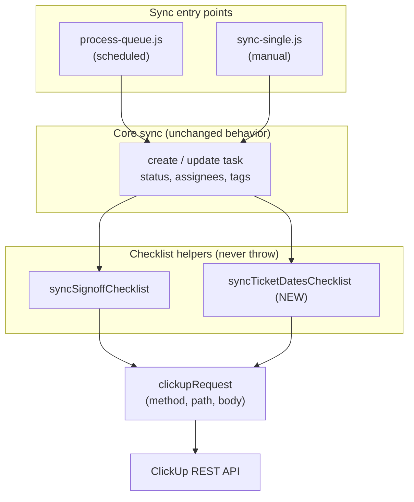
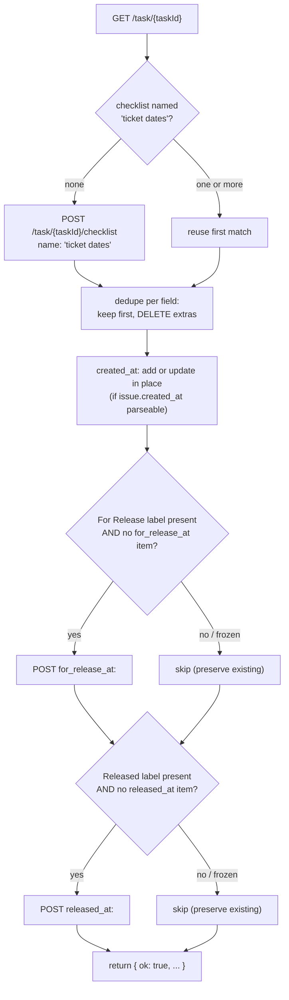

# Design Document

## Overview

The ticket-dates-sync feature adds a second reconciled ClickUp checklist — named exactly `ticket dates` — to every task touched by the GitLab→ClickUp sync. The checklist carries three date rows:

- `created_at: <date>` — derived from the GitLab issue's own `created_at` timestamp (a stable source, so it may be refreshed in place).
- `for_release_at: <date>` — the sync's own observation time, captured the first time the sync sees the "For Release" label (or a status at/after "for release" on the first sync). Frozen forever after.
- `released_at: <date>` — the sync's own observation time, captured the first time the sync sees the "Released" label. Frozen forever after, retained even if the label is later removed.

The design deliberately mirrors the existing `syncSignoffChecklist` helper in `netlify/functions/utils/signoff.js`: a single exported async function that reads the task, finds-or-creates a named checklist, reconciles its items with `POST`/`PUT`/`DELETE` calls through the caller's `clickupRequest`, and **never throws** — all failures are caught and returned as `{ ok: false, error }` so the core sync is never broken.

### Why a checklist and not custom fields

ClickUp's Free plan caps custom fields at 60 lifetime uses. An API-driven sync writing dates to custom fields would exhaust that cap almost immediately. Checklists have no such cap and already have a proven reconciliation pattern in this codebase, so a checklist is the right storage.

### Key design decisions

| Decision | Rationale |
| --- | --- |
| New module `netlify/functions/utils/ticket-dates.js` exporting `syncTicketDatesChecklist(clickupRequest, taskId, issue, status)` | Keeps date logic isolated from sign-off logic; matches the one-helper-per-checklist convention already in the codebase. |
| Checklist name is the literal string `ticket dates` | Matches requirements exactly; comparison is case-sensitive and trimmed (REQ 1.2). |
| Items matched by text **prefix** (`created_at:`, `for_release_at:`, `released_at:`) | GitLab does not expose label-add times, so values are observation-time strings that differ between syncs; prefix matching identifies the field independent of the stored value. |
| Freeze `for_release_at` / `released_at` once a non-empty value exists | First-observation semantics — history must not be rewritten by later syncs or label removal (REQ 5). |
| `created_at` may be rewritten in place | It comes from a stable GitLab source, so re-formatting it is safe and keeps format consistent (REQ 2.2, 6.4). |
| Shared UTC date formatter, fixed-width | All three rows must be character-for-character comparable (REQ 8). |
| Reuse the `labelTitlesLower` approach from `signoff.js` | Accepts both `string[]` and `{title}[]` label shapes, case-insensitively (REQ 3.5, 4.5). |
| Invoke alongside `syncSignoffChecklist` on both create and update paths in `process-queue.js` and `sync-single.js` | Date tracking must run everywhere sign-off runs, at the same path step (REQ 7.1, 7.2). |

## Architecture

The feature is one pure-ish reconciliation module plus two call-site insertions. It sits at the same layer as the sign-off helper and depends only on the caller-supplied `clickupRequest` transport.



On each sync run, after the core task create/update and after the existing `syncSignoffChecklist` call, the entry point calls `syncTicketDatesChecklist(clickupRequest, taskId, issue, status)`. The helper performs its own `GET /task/{taskId}` read (as `syncSignoffChecklist` does) rather than relying on task data the caller already has, so it always reconciles against the current checklist state.

### Reconciliation flow



If any step throws, the whole body is wrapped in a `try/catch` that logs one diagnostic naming the task and returns `{ ok: false, error }` — no write is attempted after a failed read, so existing frozen items are never touched when the read fails (REQ 5.6, 7.3).

## Components and Interfaces

### New module: `netlify/functions/utils/ticket-dates.js`

Public surface (mirrors `signoff.js` module shape — exports the main function plus small testable helpers):

```js
module.exports = {
  CHECKLIST_NAME,          // 'ticket dates'
  formatDateUtc,           // (value: string|number|Date) => string|null
  labelTitlesLower,        // (labels) => string[]  (string[] and {title}[] shapes)
  hasLabelCI,              // (labels, title) => boolean  (case-insensitive)
  fieldOf,                 // (itemText) => 'created_at'|'for_release_at'|'released_at'|null
  isFrozenField,           // (field) => boolean  (for_release_at / released_at)
  itemValue,               // (itemText) => string  (text after 'field: ')
  syncTicketDatesChecklist // the reconciliation entry point
};
```

#### `syncTicketDatesChecklist(clickupRequest, taskId, issue, status)`

| Parameter | Type | Description |
| --- | --- | --- |
| `clickupRequest` | `async (method, path, body?) => data` | Caller-supplied transport, identical to the one passed to `syncSignoffChecklist`. |
| `taskId` | `string` | ClickUp task id. |
| `issue` | `object` | The GitLab issue object. Reads `issue.created_at` and `issue.labels`. |
| `status` | `string` | The ClickUp status just applied by the core sync (used for the first-sync "status at/after for release" case in REQ 3.4). |

Returns (never throws):

```js
// success
{ ok: true, checklistId, items: { created_at: '...', for_release_at: '...'|null, released_at: '...'|null }, wrote: [...] }
// failure
{ ok: false, error: '<message>' }
```

#### Internal reconciliation steps

1. **Read** — `const task = await clickupRequest('GET', '/task/' + taskId)`. If this throws, return failure without any write (REQ 1.1, 5.6).
2. **Find or create checklist** — `task.checklists.find(c => c.name.trim() === 'ticket dates')`; if multiple, keep the first (REQ 1.3, 1.4). If none, `POST /task/{taskId}/checklist` with `{ name: 'ticket dates' }` and treat its items as `[]` (REQ 1.2).
3. **Dedupe per field** — group existing items by `fieldOf(item.name)`; for any field with more than one item, keep the first and `DELETE /checklist/{id}/checklist_item/{extraId}` the rest (REQ 6.5).
4. **created_at** — compute `formatDateUtc(issue.created_at)`. If `null` (missing/empty/unparseable), leave any existing item unchanged and do not add (REQ 2.4, 8.6). Otherwise: if an item exists, `PUT` its text to `created_at: <date>` only when the value differs (REQ 2.2, 6.4, 6.6); if none exists, `POST` one (REQ 2.1).
5. **for_release_at** — if a non-empty `for_release_at` item already exists, skip entirely (no read-only check beyond the already-performed read, no write/update/delete) (REQ 5.1, 5.2). Otherwise, if the For Release label is present **or** (first sync and status is at/after "for release" on the ladder), `POST for_release_at: <observation time>` (REQ 3.1, 3.4). If the label is absent and no item exists, do nothing (REQ 3.2).
6. **released_at** — symmetric to step 5 using the Released label (REQ 4.1, 4.2, 4.3, 5.3, 5.4).
7. **Return** `{ ok: true, ... }`.

The For Release / Released failures in steps 5–6 are covered by the single outer `try/catch`; a partial failure after a successful read still returns `{ ok: false }` and never rewrites a frozen value because writes are only attempted when the item is absent (REQ 3.6, 4.6).

### Call-site changes

**`netlify/functions/process-queue.js`** — add `const { syncTicketDatesChecklist } = require('./utils/ticket-dates');` and, immediately after each existing `await syncSignoffChecklist(...)` call (update path and create path inside `processIssue`):

```js
// Ticket dates checklist (never blocks core sync)
await syncTicketDatesChecklist(clickupRequest, taskId, item, updates.status || existing.status);
// ... and on the create path:
await syncTicketDatesChecklist(clickupRequest, newTask.id, item, status);
```

Here the queued `item` carries `created_at`, `labels`, `iid`, etc.; it serves as the `issue` object.

**`netlify/functions/sync-single.js`** — add the same `require` and, immediately after each existing `await syncSignoffChecklist(...)` call (update path and create path in the handler):

```js
// Ticket dates checklist (never blocks core sync)
await syncTicketDatesChecklist(clickupRequest, taskId, issue, updates.status || existingTask.status?.status);
// ... and on the create path:
await syncTicketDatesChecklist(clickupRequest, newTask.id, issue, status);
```

Both call sites pass the same `issue`/`item` object and the applied status, matching the sign-off invocation exactly so the ticket-dates sync runs once per task on both paths (REQ 7.1, 7.2). Because the helper never throws and its result is not folded into the core outcome, a failure leaves the committed core result unchanged (REQ 7.4).

> Note on the queued item: `process-queue.js` must ensure the queued `item` includes `created_at` and `labels`. The webhook/enqueue layer already forwards issue fields; the design assumes `item.created_at` is present. If it is absent, `formatDateUtc` returns `null` and the created_at row is simply skipped (REQ 2.4), so the sync degrades gracefully rather than breaking.

### Shared date formatter

`formatDateUtc(value)` is the single formatter used for all three rows (REQ 8.1–8.4):

- Accepts an ISO 8601 string, epoch milliseconds number, or `Date`.
- Parses with `new Date(value)`; if the result is `Invalid Date` (or the input is `null`/empty), returns `null` (REQ 8.6).
- Converts to UTC and renders a fixed-width string using UTC getters (REQ 8.5).

**Chosen format:** `YYYY-MM-DD HH:mm:ss UTC` (e.g. `2024-03-07 14:05:09 UTC`). Each component is zero-padded to a fixed width, giving a character-for-character identical structure across all three rows. This format is human-readable at a glance, sortable, and unambiguous about the timezone. The stored item text is therefore exactly `created_at: 2024-03-07 14:05:09 UTC` (and likewise for the other two fields).

## Data Models

### Checklist (as returned by ClickUp `GET /task/{taskId}`)

```js
{
  id: 'string',
  name: 'ticket dates',
  items: [
    { id: 'string', name: 'created_at: 2024-03-07 14:05:09 UTC', resolved: false /* ...other ClickUp fields */ }
  ]
}
```

### Internal field model

```js
// Result of grouping checklist items by field
{
  created_at:     { id, name, value } | null,
  for_release_at: { id, name, value } | null,  // value = text after 'for_release_at: '
  released_at:    { id, name, value } | null,
  duplicates: [ { id }, ... ]  // extra same-field items to delete
}
```

### GitLab issue (fields consumed)

```js
{
  iid: 6763,
  created_at: '2024-03-07T14:05:09.000Z',  // ISO 8601; may be absent in queued items
  labels: ['For Release', 'Released']        // or [{ title: 'For Release' }, ...]
}
```

### Item text grammar

```
item      := field ": " value
field     := "created_at" | "for_release_at" | "released_at"
value     := YYYY "-" MM "-" DD " " HH ":" mm ":" ss " UTC"
```

`fieldOf(text)` returns the field whose name the text starts with (`text.startsWith('created_at:')`, etc.); `itemValue(text)` returns `text.slice(text.indexOf(':') + 1).trim()`.

## Correctness Properties

*A property is a characteristic or behavior that should hold true across all valid executions of a system — essentially, a formal statement about what the system should do. Properties serve as the bridge between human-readable specifications and machine-verifiable correctness guarantees.*

These properties are expressed against `syncTicketDatesChecklist` driven by a **mock `clickupRequest`** backed by an in-memory fake ClickUp task/checklist store. The fake records every call (method, path, body) so ordering and mutation counts can be asserted, and applies create/update/delete so repeated syncs observe prior effects.

### Property 1: Read happens before any mutation

*For any* task checklist state, when `syncTicketDatesChecklist` runs, the `GET /task/{taskId}` read is issued before any `POST`, `PUT`, or `DELETE` call.

**Validates: Requirements 1.1, 5.5**

### Property 2: Checklist is created exactly once only when absent

*For any* set of checklists on a task, if none is named `ticket dates` (trimmed) then exactly one `POST /task/{taskId}/checklist` with name `ticket dates` is issued; if one or more already exist, zero create calls are issued and the first matching checklist is reused.

**Validates: Requirements 1.2, 1.3, 1.4**

### Property 3: Exactly one created_at item, added or updated in place

*For any* checklist state and any parseable `issue.created_at`, after the sync the checklist contains exactly one item whose text starts with `created_at:`; if a created_at item was absent it was added, if present it was updated in place (never duplicated), and if its stored value already equals the formatted value no write is issued against it.

**Validates: Requirements 2.1, 2.2, 6.4, 6.6**

### Property 4: First observation records a frozen field

*For any* sync where no `for_release_at` item exists and the For Release label is present (or, on a first sync, the applied status is at or after "for release" on the status ladder), exactly one `for_release_at: <observation time>` item is added; and symmetrically, where no `released_at` item exists and the Released label is present, exactly one `released_at: <observation time>` item is added.

**Validates: Requirements 3.1, 3.4, 4.1, 4.4**

### Property 5: No frozen-field item is created when its label is absent

*For any* sync where a frozen field's item is absent and its triggering label is absent (and, for `for_release_at`, the status is below "for release"), zero items for that field are created.

**Validates: Requirements 3.2, 4.2**

### Property 6: Freeze invariant — existing frozen values are never changed

*For any* checklist already containing a non-empty `for_release_at` or `released_at` item, and for any subsequent sequence of syncs with arbitrary label states (including the triggering label being removed), the stored value of that item is identical before and after, and no `PUT` or `DELETE` call is issued against that item's id.

**Validates: Requirements 3.3, 4.3, 5.1, 5.2, 5.3, 5.4**

### Property 7: Label matching is case-insensitive across both shapes

*For any* label set expressed either as `string[]` or as `{title}[]`, with the triggering title in any letter case, the For Release and Released labels are detected identically to a canonical lowercase comparison.

**Validates: Requirements 3.5, 4.5**

### Property 8: Duplicates collapse to exactly one item per field

*For any* checklist pre-seeded with two or more items for the same field, after the sync exactly one item for that field remains and each extra item's id received a `DELETE` call.

**Validates: Requirements 6.5**

### Property 9: Idempotent convergence over repeated syncs

*For any* initial checklist state and any number N ≥ 1 of consecutive syncs against the same fake store, the final checklist contains exactly one `created_at` item, at most one `for_release_at` item, and at most one `released_at` item.

**Validates: Requirements 6.1, 6.2, 6.3**

### Property 10: Failures resolve to a non-throwing failure result

*For any* single injected failure at the read, checklist-create, or item-write step, `syncTicketDatesChecklist` resolves (never rejects/throws) and returns `{ ok: false, error }`.

**Validates: Requirements 1.5, 3.6, 4.6, 7.3**

### Property 11: A failed read performs zero mutations and surfaces an error

*For any* sync where the initial `GET /task/{taskId}` read fails, no `POST`, `PUT`, or `DELETE` call is issued and the result is `{ ok: false, error }`, leaving any existing frozen items untouched.

**Validates: Requirements 5.6**

### Property 12: All rendered dates share one fixed-width format

*For any* set of valid source dates rendered for the three fields, every written value matches the single pattern `^\d{4}-\d{2}-\d{2} \d{2}:\d{2}:\d{2} UTC$`, giving a character-for-character identical structure across fields.

**Validates: Requirements 8.1, 8.2, 8.3, 8.4**

### Property 13: Source dates are normalized to UTC before formatting

*For any* two input values denoting the same instant but expressed with different timezone offsets, `formatDateUtc` returns the identical string, equal to the value produced from the instant's UTC components.

**Validates: Requirements 8.5**

## Error Handling

The module follows the never-throw contract of `syncSignoffChecklist`:

- **Single outer `try/catch`.** The entire reconciliation body is wrapped. Any thrown error from `clickupRequest` (network, non-2xx, JSON) is caught.
- **Failure result shape.** On catch, the function returns `{ ok: false, error: err.message }`. It never rejects.
- **One diagnostic per failure.** On catch, log exactly one line identifying the task: `console.error('[ticket-dates] Failed to sync checklist on task ' + taskId + ':', err.message)` (REQ 7.5).
- **No write after a failed read.** Because item reconciliation only runs after a successful `GET`, a read failure short-circuits before any mutating call, so existing frozen items are never touched (REQ 5.6, 11).
- **Frozen items are never targeted by writes.** `for_release_at` / `released_at` writes are attempted only when the item is absent, so a mid-run failure cannot overwrite an existing frozen value (REQ 3.6, 4.6).
- **Invalid/missing dates are not errors that abort the run.** `formatDateUtc` returning `null` is handled inline: the affected field is skipped and the other fields still reconcile (REQ 2.4, 8.6). An error indication for the unparseable value is included in the returned result's diagnostics rather than throwing.
- **Core sync isolation.** Call sites `await` the helper but ignore its boolean result for the purpose of the core response, exactly as they do for `syncSignoffChecklist`, so a `{ ok: false }` return never marks the core sync as failed (REQ 7.4).

## Testing Strategy

PBT **is** appropriate here: `syncTicketDatesChecklist` is effectively a pure reconciliation over an injected `clickupRequest`, with large input spaces (arbitrary checklist states, label shapes/cases, date values, sync counts) and strong universal invariants (idempotency, freeze, single-item-per-field, UTC formatting). The I/O boundary is mocked, so property tests are cheap to run at 100+ iterations.

### Tooling

- **Library:** [`fast-check`](https://github.com/dubzzz/fast-check) for property-based tests, run under the project's test runner. fast-check integrates with any JS runner and is the standard PBT library for Node. We will **not** hand-roll property generation.
- A property-based testing library is used rather than implementing randomized testing from scratch.
- Minimum **100 iterations** per property test (fast-check default `numRuns: 100`, set explicitly).

### Mock / fake harness

A `makeFakeClickup(initialTask)` helper returns `{ clickupRequest, calls, store }`:

- `calls` is an ordered array of `{ method, path, body }` for ordering and count assertions.
- `store` applies `POST /task/{id}/checklist`, `POST /checklist/{id}/checklist_item`, `PUT .../checklist_item/{itemId}`, and `DELETE .../checklist_item/{itemId}` so repeated syncs see prior effects (needed for Property 9).
- A `failAt(predicate)` option makes the mock reject on a matching call to exercise Properties 10 and 11.

### Generators

- Checklist states: arbitrary arrays of items with field prefixes, including zero, one, and many items per field, with empty and non-empty values.
- Labels: arbitrary sets drawn from a pool including `For Release` / `Released` in mixed case, emitted as both `string[]` and `{title}[]`.
- Dates: valid ISO strings (with varied offsets) for the happy path; a separate edge generator yielding `''`, `null`, `undefined`, and non-ISO junk for the unparseable cases.
- Statuses: values from the status ladder, including at/after and below "for release".

### Property tests

Each correctness property maps to exactly **one** property-based test, tagged with a comment referencing the design property:

```
// Feature: ticket-dates-sync, Property 6: Freeze invariant — existing frozen values are never changed
```

Tag format for every property test: **Feature: ticket-dates-sync, Property {number}: {property_text}**. The 13 properties above become 13 property tests (P1–P13).

### Unit (example) tests

Focused example and edge-case tests complement the property tests:

- **Unparseable created_at (REQ 2.4, 8.6):** `issue.created_at` of `''`, `null`, and `'not-a-date'` — assert no created_at write and other fields still reconcile.
- **Diagnostic on failure (REQ 7.5):** spy on `console.error`; inject a failure; assert exactly one diagnostic containing the task id.
- **Format snapshot:** assert `formatDateUtc('2024-03-07T14:05:09.000Z') === '2024-03-07 14:05:09 UTC'`.

### Integration / call-site tests (not PBT)

These verify wiring, which does not vary meaningfully with input (REQ 7.1, 7.2, 7.4):

- **process-queue `processIssue`:** with a mocked `clickupRequest`, run the create path and the update path; assert `syncTicketDatesChecklist` is called exactly once on each, immediately after `syncSignoffChecklist`, with `(clickupRequest, taskId, item, appliedStatus)`.
- **sync-single handler:** same assertions for the manual create and update paths with the `issue` object.
- **Core isolation:** force the helper to return `{ ok: false }` (and separately to reject — it must not) and assert the handler still returns its core success response unchanged.

Both unit and property tests are necessary: unit tests pin concrete examples and the exact formatted string; property tests guarantee the universal invariants (idempotency, freeze, single-item-per-field, UTC formatting) hold across the full input space.
